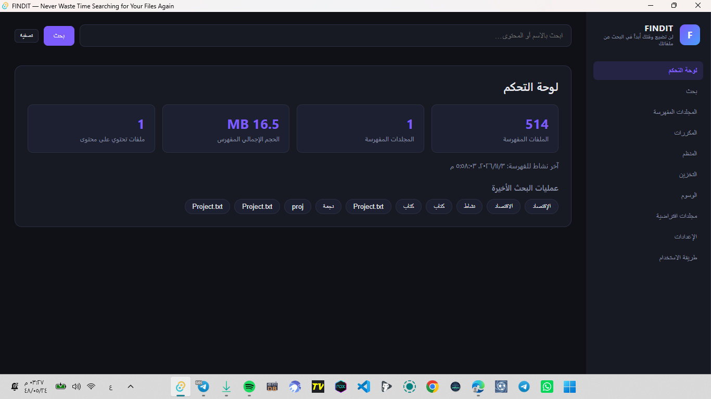
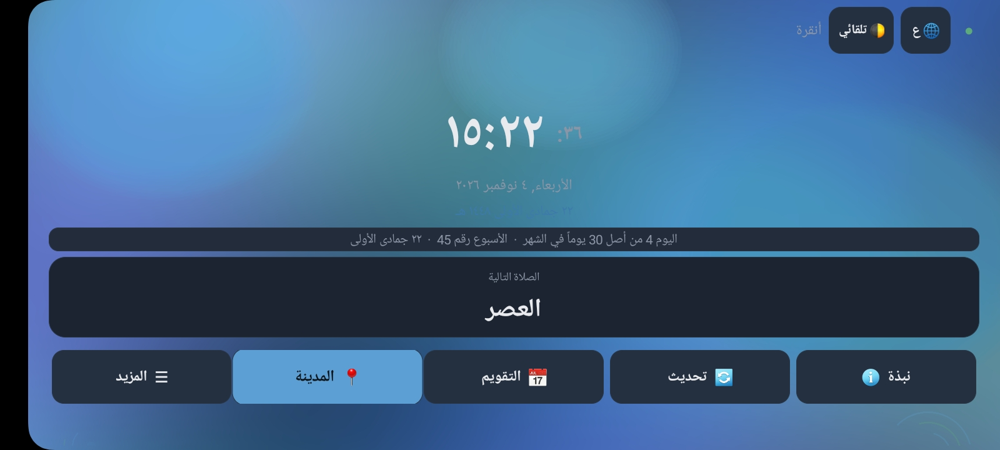
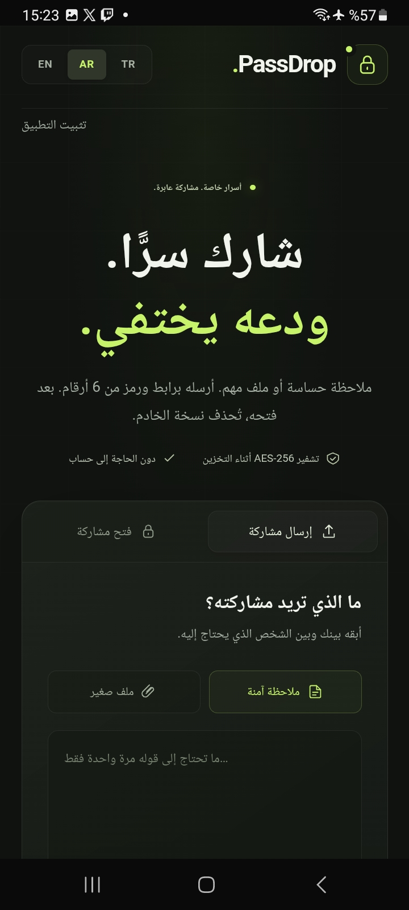
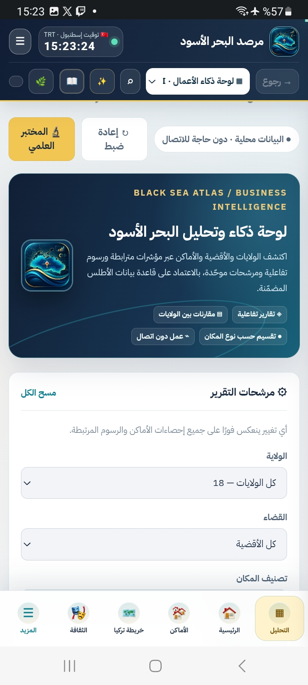
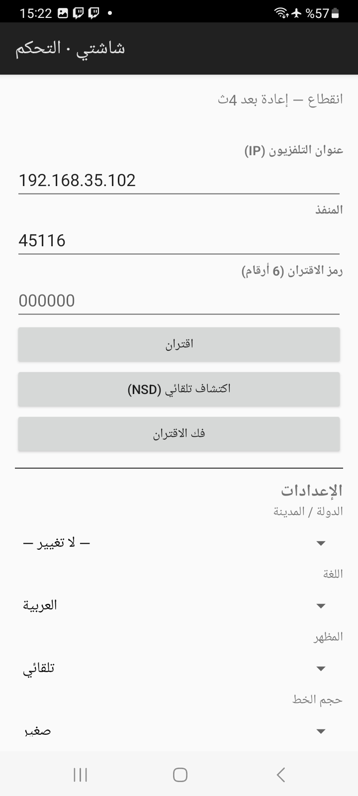
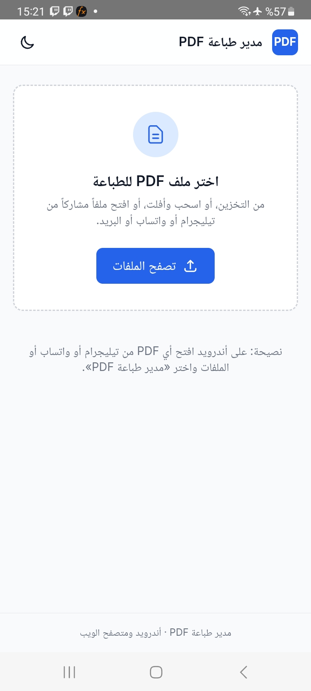
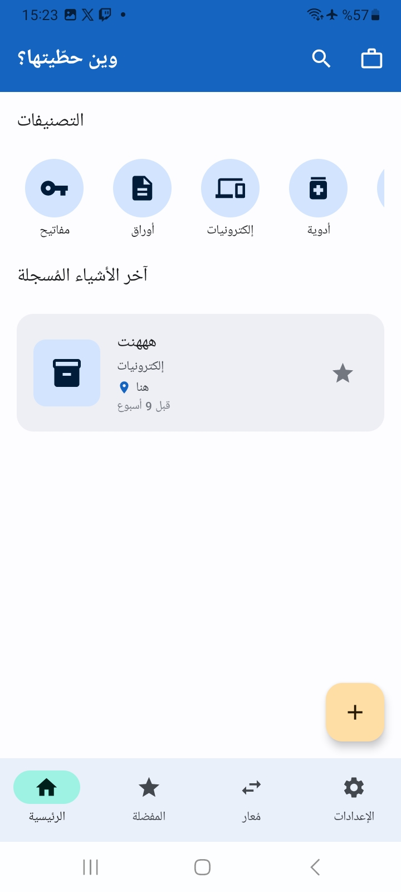
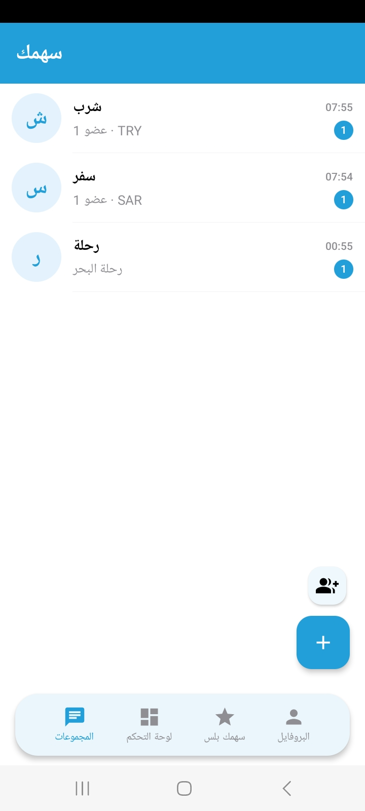

  <h1>💼 مطور تطبيقات وبرمجيات | Moteeh Damlakhy</h1>
  
<b>Android • Android TV • Windows Software • MSI Packaging</b>

  
<i>"أحول الأفكار المعقدة إلى تطبيقات وبرمجيات سلسة، عملية، وذات واجهات مستخدم استثنائية."</i>

  
  
  

---

## 🚀 نبذة عني
مطور برمجيات متخصص في بناء حلول رقمية متكاملة عبر منصات متعددة. أمتلك خبرة واسعة في تطوير تطبيقات الهواتف الذكية، تطبيقات شاشات Android TV وصناديق البث (TV Box)، وبرامج سطح المكتب لنظام Windows. أهتم بالتفاصيل الدقيقة، أمان البيانات، وتجربة المستخدم (UI/UX) لضمان تقديم منتجات نهائية عالية الجودة تلبي احتياجات السوق العربي والتركي.

## 🛠️ الخدمات التي أقدمها
- **📱 تطبيقات الأندرويد:** بناء تطبيقات هواتف وأجهزة لوحية بأداء عالٍ وواجهات عصرية.
- **📺 تطبيقات Android TV:** تصميم واجهات مخصصة للشاشات الكبيرة وأجهزة TV Box.
- **💻 برامج Windows:** تطوير برامج مخصصة، أدوات إنتاجية، وإنشاء ملفات تثبيت MSI.
- **🔒 الأمن والتشفير:** دمج بروتوكولات الحماية وتشفير البيانات الحساسة.
- **🔗 التكامل الشبكي:** تطوير أدوات تحكم عن بُعد (IP/Ports) وتطبيقات تعتمد على الشبكات المحلية.

---

## 🌟 معرض الأعمال (Featured Projects)

### 1️⃣ FINDIT (برنامج Windows - سطح المكتب)
> **الوصف:** أداة بحث متطورة لنظام Windows تهدف إلى إنهاء معاناة البحث عن الملفات.
> **المميزات:** فهرسة فائقة السرعة، واجهة مستخدم مظلمة (Dark Mode) أنيقة، لوحة تحكم تعرض إحصائيات دقيقة، وذاكرة للبحث الأخير.
> **التقنيات:** Windows Desktop, Local Database, UI/UX.

---

### 2️⃣ تطبيق الساعة والصلوات (Android TV / TV Box)
> **الوصف:** تطبيق مخصص للشاشات الذكية يعرض الوقت والتقويم الهجري ومواقيت الصلاة.
> **المميزات:** واجهة ضخمة وواضحة مناسبة للمسافات البعيدة، تصميم مريح للعين، تكامل مع بيانات الموقع الجغرافي.
> **التقنيات:** Android TV, Location Services, UI Design.

---

### 3️⃣ PassDrop (تطبيق مشاركة آمنة)
> **الوصف:** منصة لمشاركة الملاحظات والملفات الحساسة بشكل آمن ومؤقت.
> **المميزات:** تشفير البيانات (AES-256)، إمكانية حذف البيانات ذاتياً بعد قراءتها (Self-destruct)، لا يتطلب تسجيل حساب.
> **التقنيات:** AES-256 Encryption, Secure Data Transfer.

---

### 4️⃣ مرصد البحر الأسود (Black Sea Atlas - تطبيق BI)
> **الوصف:** تطبيق ذكاء أعمال (Business Intelligence) وتحليل بيانات جغرافية واقتصادية.
> **المميزات:** لوحة تحكم تفاعلية، خرائط حرارية ومقارنات (18 ولاية تركية)، فلترة متقدمة للبيانات، وتقارير تعمل دون إنترنت.
> **التقنيات:** Data Visualization, Interactive Maps, Offline Data Processing.

---

### 5️⃣ شاشتي - التحكم (Android Remote Control)
> **الوصف:** تطبيق يعمل كجهاز تحكم عن بُعد للشاشات وأجهزة الاستقبال.
> **المميزات:** اكتشاف تلقائي للأجهزة عبر الشبكة (NSD)، الاتصال المباشر عبر IP والمنفذ (Port)، دعم كامل للغات.
> **التقنيات:** Network Sockets, IP/Ports, Local Network Discovery.

---

### 6️⃣ أدوات مساعدة (Utilities)
#### 📄 مدير طباعة PDF
> تطبيق أندرويد لفتح، تصفح، وإدارة ملفات PDF بسهولة استعداداً لطباعتها.

#### 📍 وين حطيتها؟ (Item Tracker)
> تطبيق لتنظيم وتذكر أماكن الأشياء المهمة (مفاتيح، أوراق، إلكترونيات).

#### 💰 سهمك (Expense Splitter)
> تطبيق مالي عملي لتقسيم الفواتير والمصاريف بين الأصدقاء والمجموعات بكل سهولة.

---

## 🤝 متاح للتعاون
أنا متاح لتحويل فكرتك إلى تطبيق، أو تطوير مشروعك الحالي. لا تتردد في التواصل معي لمناقشة متطلباتك وميزانيتك. متاح للعملاء العرب والأتراك (عن بُعد).

- **رقم الهاتف / واتساب:** 00963980306895
- **البريد الإلكتروني:** moteehdamlakhy86@gmail.com
